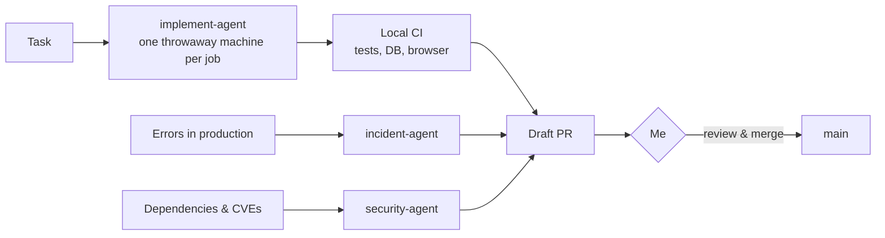

# You don't need a team. You need agents.

I'm building **EpochZro**, a 1-person agent business. AI agents do the work that used to need
departments: engineering, marketing, support and finance. I set the direction, review the output
and merge. Everything is built in public.

## How the agents work

The rules they work by:

- **A human merges.** Agents open draft PRs. Only plain dependency updates go in automatically.
- **Agents don't edit their own memory.** They propose changes, I accept or reject them.
- **Every run is traced and reviewed.**

## Built with this setup

| | |
|---|---|
| **Lindoza** | Voice AI to rehearse the conversations where you usually cave · [lindoza.com](https://lindoza.com) |
| **Summavo** | Premium online summits built from a single brief · [summavo.com](https://summavo.com) |
| **Cordeiro** | New websites for restaurants, updated via WhatsApp · [getcordeiro.com](https://getcordeiro.com) |

## Under the hood

Claude Code · Codex · MCP · Hetzner · Talos Kubernetes · Terraform / Terragrunt · ArgoCD ·
Tailscale · Plane · Langfuse · Next.js · Postgres

## Follow along

Workflows, wins and failures from running a business with agents:
[TikTok @epochzro](https://www.tiktok.com/@epochzro) · [X @BennyLison](https://x.com/BennyLison) ·
[LinkedIn](https://www.linkedin.com/in/bejavue/)
